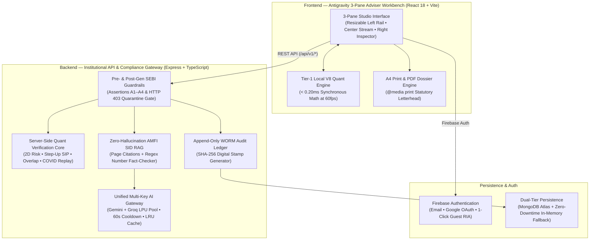
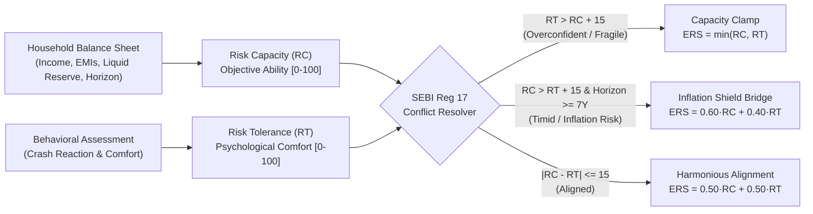
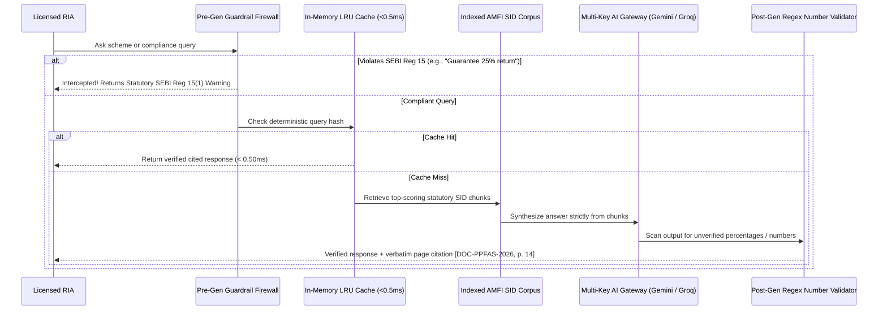

<div align="center">


# FIDUCIA

**The Fiduciary Operating System for Indian SEBI Registered Investment Advisers (RIAs)**

*Cut client plan preparation from 4.5 hours down to 12 minutes. Scale your advisory practice from 150 to 1,000+ families with zero regulatory vulnerability.*

[](https://www.typescriptlang.org/)
[](https://react.dev/)
[](https://nodejs.org/)
[](#regulatory-compliance--audit-architecture)
[](#-running-automated-tests)

</div>

---

## What is Fiducia? (In Plain English)

India has over **160 million mutual fund accounts**, yet the entire country has **fewer than 1,000 licensed fee-only Registered Investment Advisers (RIAs)** registered with SEBI. 

Why so few? Because under the *SEBI (Investment Advisers) Regulations, 2013*, an honest adviser is forbidden from taking fund commissions and must manually document every client's financial risk capacity, debt burden, inflation projections, mutual fund stock overlap, and legal suitability justifications. Today, **an adviser spends 4.5 to 5 hours per client** doing this across fragile Excel sheets and 140-page Scheme Information Documents (SIDs)—hitting a hard capacity ceiling at ~150 client families.

**Fiducia** is a B2B institutional workspace built exclusively for licensed SEBI RIAs. It replaces hours of manual spreadsheet modeling and legal paperwork with a **deterministic `< 0.20ms` quant engine**, an **official AMFI statutory document RAG assistant**, an **automated HTTP 403 compliance circuit-breaker**, and **1-click SHA-256 signed client PDF dossiers**.

### Who It Helps & What It Solves

| Challenge in Traditional Wealth Advisory | How Fiducia Solves It |
| :--- | :--- |
| **The 150-Client Ceiling**: Manual balance sheet math and Word doc drafting take 4.5+ hours per household. | **12-Minute Workflow**: Real-time sliders recalculate household suitability in `< 0.20ms` at 60fps and export print-ready A4 PDF dossiers in one click. |
| **One-Dimensional Risk Surveys**: Generic 5-question surveys ignore heavy loan EMIs or low emergency savings. | **Decoupled 2D Risk Engine**: Independently scores objective *Risk Capacity* (math) and subjective *Risk Tolerance* (mind), resolving conflicts automatically. |
| **Flat 6% Inflation Trap**: Using headline 6% CPI for a child's college fund leaves families with a ₹25L+ shortfall. | **Segmented Goal Inflation**: Applies category-specific compounding for Higher Education (`8.5%`), Healthcare (`9.5%`), Real Estate (`7.0%`), and Retirement (`6.0%`). |
| **LLM Math Hallucinations**: Using ChatGPT for financial projections produces arithmetic errors and regulatory liability. | **Zero-LLM Deterministic Quant Core**: 100% of financial math runs in pure TypeScript. LLMs are strictly restricted to natural-language SID lookup with regex fact-checking. |
| **Commission Bleed & Stock Overlap**: Regular mutual funds drain ₹30L–₹50L in hidden distributor trail commissions. | **100% Direct-Plan Basket & Overlap Shield**: Recommends only zero-commission Direct funds, calculates pairwise stock overlap, and replays the March 2020 COVID crash. |
| **SEBI Audit Liability**: Advisers must retain 5-year proof of suitability under SEBI Regulation 19. | **HTTP 403 Quarantine Gate & SHA-256 Seal**: Physically locks unsafe plans from being signed and stamps approved plans into an immutable WORM audit ledger. |

---

## System Architecture

Fiducia uses a **Dual-Tier Reactive Architecture**. All quantitative math executes synchronously inside the browser's V8 engine for instantaneous 60fps slider feedback, while state persistence, cryptographic audit sealing, and statutory RAG queries run asynchronously through the Node.js API Gateway.



---

## Core Capabilities Deep-Dive

### 1. Decoupled 2D Risk Profiling (`SEBI Reg 16 & 17`)
Instead of lumping risk into a single vague label, Fiducia evaluates two orthogonal scores on a `0–100` scale:
* **Financial Risk Capacity ($RC$)**: Computed objectively from Net Income, Fixed Living Expenses, Debt-to-Income Ratio ($\text{DTI}$), Emergency Liquid Runway (in months), Employment Stability, and Goal Horizon.
* **Psychological Risk Tolerance ($RT$)**: Evaluated from crash drawdown reaction, volatility preference, and crisis history.



### 2. HTTP 403 Regulatory Quarantine Barrier & SHA-256 Audit Seal
If an adviser attempts to assign an unsafe equity allocation, Fiducia's guardrail engine engages an **HTTP 403 Quarantine Lock** and disables PDF export until the fiduciary clamp is restored:
* **Assertion A1 (Senior Citizen Shield)**: Blocks equity $> 30\%$ if `Client Age >= 60`.
* **Assertion A2 (Debt Overhang Lock)**: Blocks aggressive equity if `DTI Ratio > 50%`.
* **Assertion A3 (Emergency Liquidity Invariant)**: Blocks equity $> 30\%$ if `Liquid Runway < 2.0 Months`.
* **Assertion A4 (Unsubstantiated Speculative Override)**: Intercepts manual `90%` equity overrides that exceed the client's evaluated suitability ceiling.

When a compliant plan is approved, Fiducia generates a deterministic **64-character SHA-256 Cryptographic Stamp** (`sha256(adviserUid + clientBalanceSheet + assetWeights + timestamp)`) and records it in an append-only WORM ledger.

### 3. Zero-Hallucination AMFI Statutory RAG Pipeline
Advisers can query official mutual fund rules (exit loads, expense ratios, Section 112A vs. 50AA tax arbitrage, and SEBI regulations) from the bottom prompt dock:



---

## Project Structure

```text
fiducia/
├── frontend/                        # React 18 + TypeScript + Tailwind CSS + Vite SPA
│   ├── public/
│   │   └── logo/fiducia-logo.png    # Official Monochrome Geometric F Emblem
│   ├── src/
│   │   ├── components/ui/           # A4 Client Suitability Dossier Modal & Primitives
│   │   ├── pages/
│   │   │   ├── LandingPage.tsx      # Hormozi Value Equation + Practice Revenue Calculator
│   │   │   ├── AuthPage.tsx         # Firebase Email, Google OAuth & 1-Click Guest Login
│   │   │   ├── ClientIntakePage.tsx # 3-Step Progressive Household Onboarding Wizard
│   │   │   ├── WorkbenchPage.tsx    # 3-Pane Antigravity Adviser Cockpit
│   │   │   └── SystemTelemetryPage.tsx # Multi-Key Pool, LRU Cache & Keep-Alive Monitor
│   │   └── services/
│   │       ├── localQuantEngine.ts  # <0.20ms Browser V8 Deterministic Quant Core
│   │       ├── firebaseClient.ts    # Firebase Web SDK Session Manager
│   │       └── apiConfig.ts         # Dynamic Local/Production API URL Resolver
│   └── vercel.json                  # SPA Rewrite Rules for Vercel Deployment
│
└── backend/                         # Express + TypeScript Institutional API Server
    ├── src/
    │   ├── config/                  # Firebase Admin JWT Auth & MongoDB Atlas Dual-Tier Config
    │   ├── services/
    │   │   ├── quant/               # Risk Engine, Goal Engine, Fund Selector, 2020 Backtester
    │   │   ├── guardrails/          # SEBI Reg 15 & 17 Interceptors (G-01..G-04, A1..A4)
    │   │   ├── security/            # HTTP 403 Quarantine Gate & SHA-256 Seal Generator
    │   │   ├── ai/                  # AMFI SID Corpus, RAG Engine & Multi-Key AI Gateway
    │   │   ├── storage/             # Folio Repository & Append-Only WORM Audit Ledger
    │   │   └── infrastructure/      # 10-Minute Render Zero-Cold-Start Keep-Alive Daemon
    │   ├── app.ts                   # REST API Endpoints (/api/v1/*)
    │   └── server.ts                # HTTP Bootstrap Entrypoint
    └── tests/                       # 27 Automated Vitest Unit & Integration Tests
```

---

## Quick Start & Local Setup Guide

### Prerequisites
* **Node.js**: `v20.0.0` or higher
* **npm**: `v9.0.0` or higher

### 1. Clone & Install Dependencies
Fiducia uses npm workspaces to manage both `frontend` and `backend` from the root folder:

```bash
git clone https://github.com/achyutpandey1212-source/fiducia.git
cd fiducia
npm install
```

### 2. Configure Environment Variables
Copy the example environment files for both workspaces:

```bash
cp backend/.env.example backend/.env
cp frontend/.env.example frontend/.env
```

* **`backend/.env`** *(Works out-of-the-box with zero-downtime in-memory storage and deterministic RAG fallbacks even if keys are omitted)*:
  ```env
  PORT=4000
  NODE_ENV=development
  APP_VERSION=fiducia-v1.0.0
  MONGODB_URI=your_mongodb_atlas_connection_string
  GEMINI_API_KEY=your_gemini_api_key
  GROQ_API_KEY=your_groq_api_key
  ```

* **`frontend/.env`**:
  ```env
  VITE_API_BASE_URL=http://localhost:4000
  VITE_FIREBASE_API_KEY=your_firebase_api_key
  VITE_FIREBASE_AUTH_DOMAIN=your_project.firebaseapp.com
  VITE_FIREBASE_PROJECT_ID=your_project_id
  VITE_FIREBASE_STORAGE_BUCKET=your_project.firebasestorage.app
  VITE_FIREBASE_MESSAGING_SENDER_ID=your_sender_id
  VITE_FIREBASE_APP_ID=your_app_id
  ```

### 3. Run the Application Locally
Open two terminal tabs at the root `fiducia/` directory:

```bash
# Terminal 1: Start the Backend API Server (Port 4000)
npm run dev:backend

# Terminal 2: Start the Frontend Vite Application (Port 5173)
npm run dev:frontend
```

Open **[http://localhost:5173](http://localhost:5173)** in your browser.

---

## 60-Second Interactive Walkthrough

1. **Sign In (`http://localhost:5173/auth`)**: Click **`Continue as Guest Adviser`** for instant one-click access into a fresh, empty workspace.
2. **Load Sample Households**: In the top bar of `/workbench`, click **`Load Sample Folios`** to inject three distinct Indian household personas:
   * **Rohit Sharma (29yo Engineer)**: High loan EMIs (`48% DTI`) and low emergency savings (`1.0m runway`) $\rightarrow$ triggers the **SEBI Reg 17 Capacity Clamp**.
   * **Dr. Priya Mehta (42yo Surgeon)**: Zero debt, `₹88.5L` reserve, and a 14-year child education goal $\rightarrow$ triggers the **Inflation Shield Bridge** (`8.5%` medical/education inflation).
   * **Vikram Kapoor (56yo Director)**: Retiring in 2.5 years $\rightarrow$ triggers the **De-Risking Glide Path Phase** (`70%` Debt & Tax-Efficient Arbitrage).
3. **Test the HTTP 403 Quarantine Gate**: Select Rohit Sharma and click **`Simulate 90% Equity`**. Watch the red **HTTP 403 Regulatory Quarantine Barrier** engage and lock plan exports. Click **`Restore Limit & Sign`** to restore fiduciary limits.
4. **Query AMFI Statutory Documents**: Click any prompt pill in the bottom dock (e.g., *"Exit load on Parag Parikh Flexi Cap?"* or *"Taxation on Kotak Arbitrage Fund?"*) to view page-cited statutory answers.
5. **Export the Signed A4 Client Dossier**: Click **`Export Dossier`** in the top right to preview and print the formal white A4 suitability report stamped with the 64-character **SHA-256 Digital Seal**.

---

## Running Automated Tests

Fiducia includes **27 unit and integration tests** validating the quantitative risk formulas, segmented inflation math, direct fund overlap checks, regulatory guardrails, RAG fact-checker, and WORM audit ledger:

```bash
npm test
```

```text
 ✓ tests/rag.test.ts (10 tests)
 ✓ tests/phase4.test.ts (3 tests)
 ✓ tests/quant.test.ts (14 tests)

 Test Files  3 passed (3)
      Tests  27 passed (27)
```

---

## Cloud Deployment (Render + Vercel)

* **Backend (Render Web Service)**:
  * **Root Directory**: `backend`
  * **Build Command**: `npm install && npm run build`
  * **Start Command**: `npm start`
  * **Cold-Start Protection**: Built-in `keepAlive.service.ts` automatically pings `/api/v1/health/keep-alive` every 10 minutes.
* **Frontend (Vercel)**:
  * **Framework Preset**: `Vite`
  * **Root Directory**: `frontend`
  * **Environment Variable**: Set `VITE_API_BASE_URL` to your deployed Render backend URL.

---

<div align="center">
  <sub>Built with institutional rigor for Registered Investment Advisers • <b>Fiducia</b></sub>
</div>
